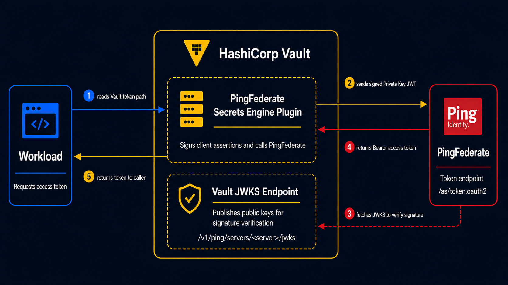

# Vault PingFederate Secrets Engine

A HashiCorp Vault secrets engine plugin that issues short-lived OAuth
access tokens from a PingFederate server using **Private Key JWT** client
authentication.

## Overview

Workloads call `vault read <mount>/clients/<server-name>/<client-name>/token`
and Vault returns a fresh access token from PingFederate. No long-lived
`client_secret` is stored anywhere. The engine proves its identity to
PingFederate with a short-lived JWT it signs itself.

## What the plugin does

The engine manages its own RSA signing keys per PingFederate server and
rotates them automatically. It publishes the public keys at an
unauthenticated JWKS endpoint that PingFederate fetches to verify the
engine's assertions. On each token request the engine signs a fresh JWT,
exchanges it at PingFederate's `/as/token.oauth2` endpoint, and returns
the access token directly to the caller. No Vault lease is created and
nothing is written to storage.

## Scope

**In scope:** one or more PingFederate servers per mount, one or more
clients per server tied to manually-configured PingFederate OAuth clients,
Private Key JWT signing (RSA-2048 / RS256) with reserved-claim protection,
and client-config metadata merged into the JWT as extra claims.

**Out of scope:** Dynamic Client Registration, Vault identity entity /
entity-alias metadata as claim sources, and algorithm agility (EC /
ES256).

## How it works



The engine exposes four logical paths under whichever mount path you
choose (`ping/` is used in the examples below):

| Path | Purpose |
|---|---|
| `ping/servers/<server-name>` | PingFederate server configuration |
| `ping/servers/<server-name>/jwks` | Public JWKS — fetched by PingFederate to verify the engine's signatures (unauthenticated) |
| `ping/clients/<server-name>/<client-name>` | Client configuration tied to a server |
| `ping/clients/<server-name>/<client-name>/token` | Retrieve a short-lived access token |

> This README assumes Vault and PingFederate are already installed and
> reachable from each other. It does not cover provisioning either
> product.

## Build

Requires Go 1.24 or newer.

```bash
make build
# Produces bin/vault-plugin-secrets-pingfederate
```

The binary must be built for the same OS and CPU architecture as the
Vault server where it will run. Cross-compile with `GOOS` and `GOARCH` if
your build host differs from the Vault host. For example, to build for a
Linux x86_64 Vault server:

```bash
GOOS=linux GOARCH=amd64 make build
```

## Install and mount

Copy the binary into the `plugin_directory` configured for your Vault
server, register it with its SHA-256, and mount the engine. The exact
plugin directory is whatever you set in your Vault server configuration;
`/opt/vault/plugins` is a common Linux default and is used in the
examples below.

```bash
sudo install -o vault -g vault -m 0755 \
  bin/vault-plugin-secrets-pingfederate \
  /opt/vault/plugins/vault-plugin-secrets-pingfederate

SHA="$(sha256sum /opt/vault/plugins/vault-plugin-secrets-pingfederate | cut -d' ' -f1)"

vault plugin register -sha256="$SHA" \
  secret vault-plugin-secrets-pingfederate

vault secrets enable -path=ping vault-plugin-secrets-pingfederate
```

On macOS, calculate the checksum with `shasum -a 256` instead of
`sha256sum`.

## Configure Vault

### Server

```bash
vault write ping/servers/<server-name> \
  ping_url=<pingfederate-base-url>
```

| Field | Default | Description |
|---|---|---|
| `ping_url` (required) | — | PingFederate base URL, e.g. `https://pingfederate.example.com:9031`. |
| `rotation_period` | `24h` | Signing key rotation period. Minimum `12h`. |
| `disable_tls_validation` | `false` | Skip TLS verification on calls to PingFederate. **Sandbox/testing only.** |

### Client

```bash
vault write ping/clients/<server-name>/<client-name> \
  client_id=<pingfederate-client-id> \
  metadata=environment=prod
```

| Field | Default | Description |
|---|---|---|
| `client_id` (required) | — | The client ID configured in PingFederate. Becomes `iss` and `sub` in the JWT. |
| `metadata` | `{}` | `key=value` pairs merged into the JWT as extra claims. Reserved claim names (`iss`, `sub`, `aud`, `exp`, `iat`, `nbf`, `jti`) are silently dropped. |
| `assertion_ttl` | `60s` | Lifetime of the signed JWT assertion. |
| `scopes` | `[]` | OAuth scopes to request. |
| `grant_type` | `client_credentials` | OAuth grant type. |

## Configure PingFederate

For each Vault client configuration, create a matching OAuth client in
the PingFederate console:

1. Create the client with the same `client_id` you used in Vault.
2. Set authentication to **Private Key JWT**.
3. Set **`jwks_url`** to:
   ```
   <VAULT_ADDR>/v1/ping/servers/<server-name>/jwks
   ```
   This endpoint is unauthenticated. PingFederate fetches and caches it
   (default ~6 hours).
4. Optionally enable **Replay Prevention**. The engine emits a unique
   `jti` per assertion.
5. Configure an **Access Token Management** policy and **Access Token
   Mappings** for the claims your application requires.

## Retrieve an access token

```bash
vault read ping/clients/<server-name>/<client-name>/token
```

The response contains `access_token`, `token_type`, `expires_in`, and
optionally `scope`. No Vault lease is created.

## Security notes

- Private signing keys are stored only in Vault's barrier-encrypted
  storage and are never returned by any read path.
- The JWKS endpoint exposes public keys only.
- `disable_tls_validation` is intended for sandbox testing — do not
  enable it in production.
- The plugin does not intentionally log assertions, access tokens, or
  private keys.
- Access to token paths should be restricted with Vault policies so that
  only authorized workloads can retrieve tokens.

## License

Licensed under the Apache License, Version 2.0. See [LICENSE](LICENSE) for the
full text.
